<h1 align="center">My Week</h1>

<p align="center">
  A weekly class timetable that adds up your hours, warns you about clashes, and keeps every account's courses safe in the cloud.
</p>

<p align="center">
  
  
  
  
  
  
</p>

<p align="center">
  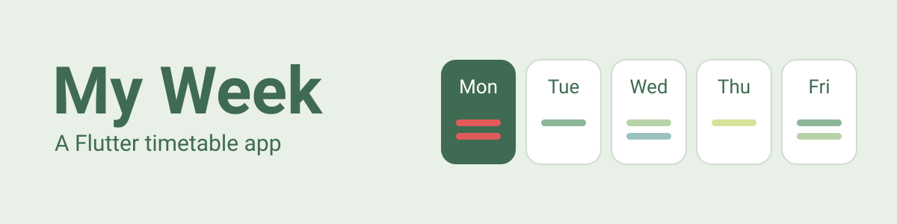
</p>

<p align="center">
  <sub>Mobile Programming, AIC | Session 5 mini project, upgraded in the Session 6 assignment (Firebase)</sub>
</p>

---

<h2 align="center">About the project</h2>

My Week is a small Flutter app I built as a beginner. I wrote this README the way I would explain the project to another beginner who wants to learn from it.

**Project chosen:** My Week, from the Mini Project Building list.

**What changed in Session 6:** in Session 5 the courses were saved on one device only. Now each person has an account, and their courses live in Firebase (Cloud Firestore), so they follow the account and not the phone.

What the app does:

- **Accounts:** create an account (email, password and a confirm-password box), log in and log out. Wrong input gets a clear message, for example "Passwords do not match" or "Wrong email or password".
- Shows one day at a time (Monday to Friday) as cards with the real date of the current week.
- Lists that day's courses in order of start time, with the total hours for the day and for the whole week.
- Marks clashing courses in red and names every course they clash with.
- Adds and edits courses with a form that refuses invalid input: an empty name, times like `8h` or `25:00`, or an end time that is not after the start time.
- Deletes a course after an "Are you sure?" confirmation, with an Undo option.
- **Saves every course in Firestore** under the logged-in user. The list updates by itself, even when the data is changed from the Firebase console.
- Shows a quote from an online API, with a loading spinner, a clear error message and a Retry button when there is no internet.

---

<h2 align="center">Project at a glance</h2>

| | |
|---|---|
| Screens | 3 (login and create account, week view, add and edit form), plus a delete confirmation |
| Source files | 4 (`main.dart`, `quote.dart`, `login_screen.dart`, `auth_gate.dart`) |
| Packages | 4 (`http`, `firebase_core`, `firebase_auth`, `cloud_firestore`) |
| Online API | 1 (DummyJSON quotes, no account needed) |
| Saved in Firestore | One document per course, at `users/{userId}/courses/{courseId}` |
| States on the week screen | 3 (loading, error, data), plus an empty message for a free day |
| States on the quote card | 3 (loading, error, data) |

---

<h2 align="center">Screenshots (Session 6, Firebase)</h2>

<table align="center">
  <tr>
    <td align="center">
      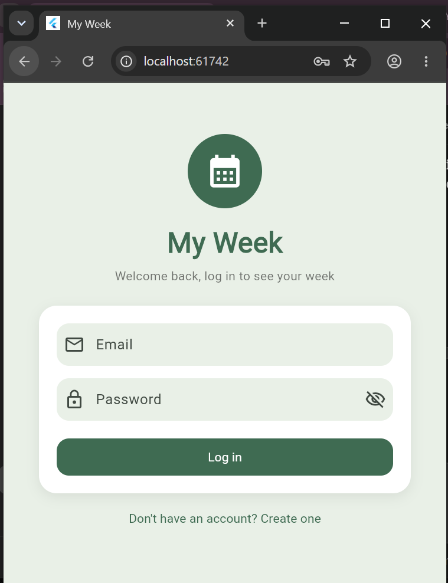<br>
      <sub>Login screen with the show/hide password eye.</sub>
    </td>
    <td align="center">
      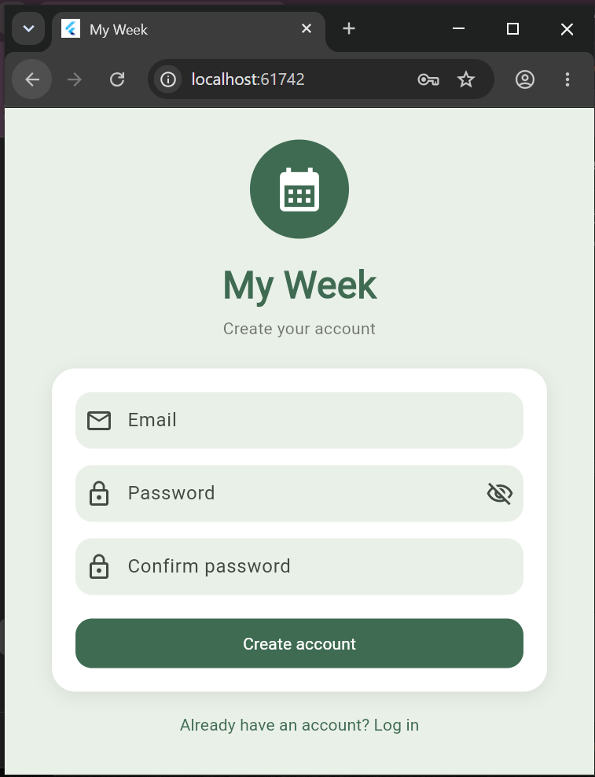<br>
      <sub>Create account: a third box asks to confirm the password.</sub>
    </td>
  </tr>
  <tr>
    <td align="center">
      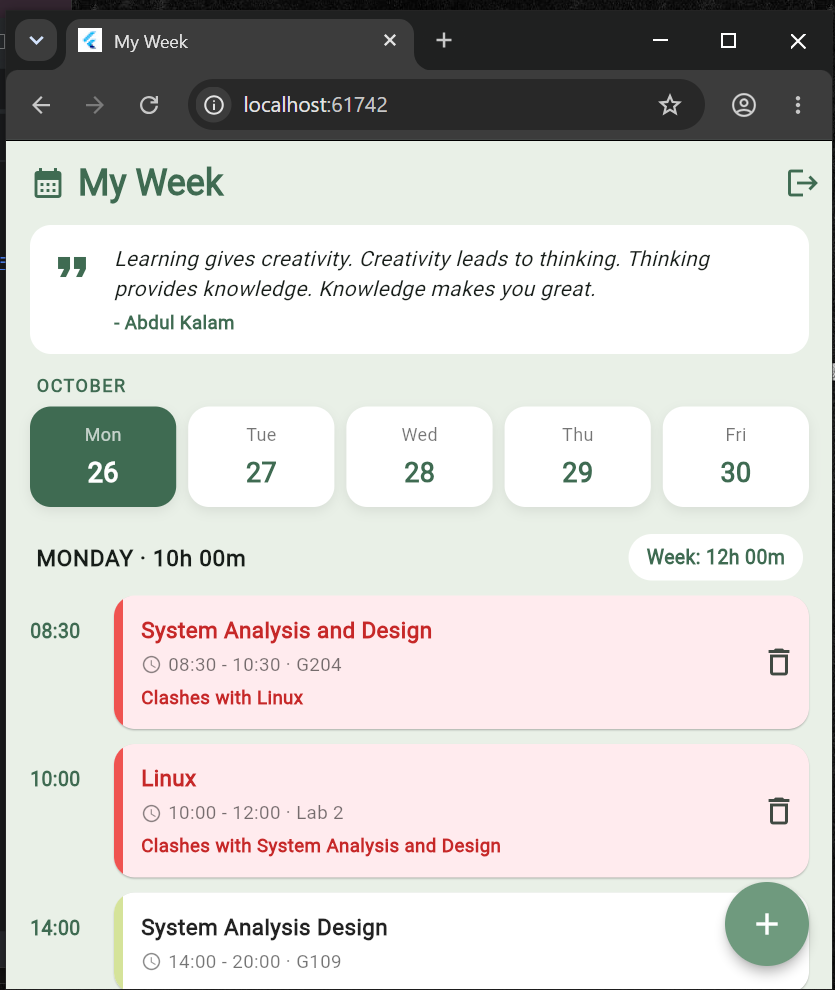<br>
      <sub>The week screen, loaded live from Firestore, with clashes in red.</sub>
    </td>
    <td align="center">
      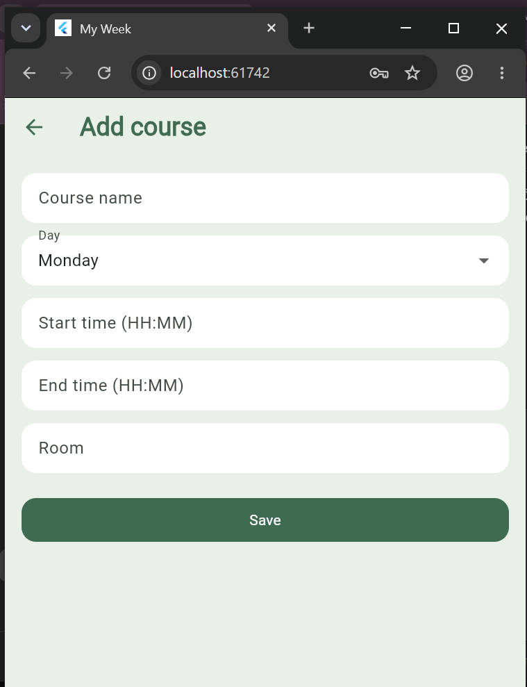<br>
      <sub>The add course form. Saving writes a new document in Firestore.</sub>
    </td>
  </tr>
  <tr>
    <td align="center">
      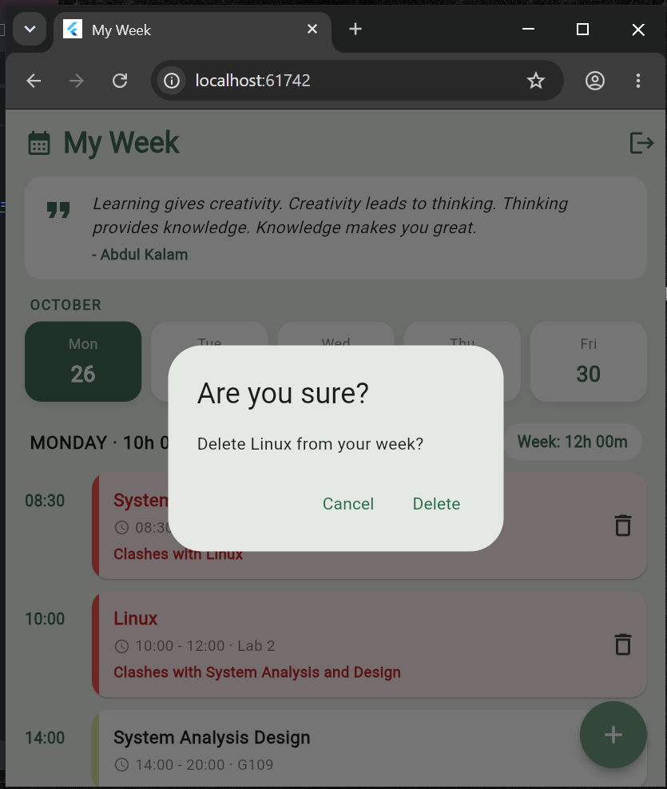<br>
      <sub>Delete asks "Are you sure?" first, and then offers Undo.</sub>
    </td>
    <td align="center">
      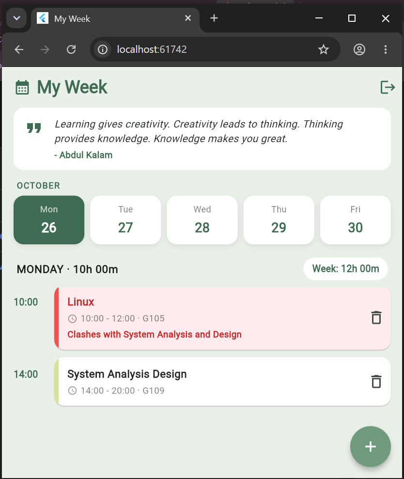<br>
      <sub>The app after I changed a room in the console, with no refresh.</sub>
    </td>
  </tr>
</table>

**Proof in the Firebase console:**

<table align="center">
  <tr>
    <td align="center">
      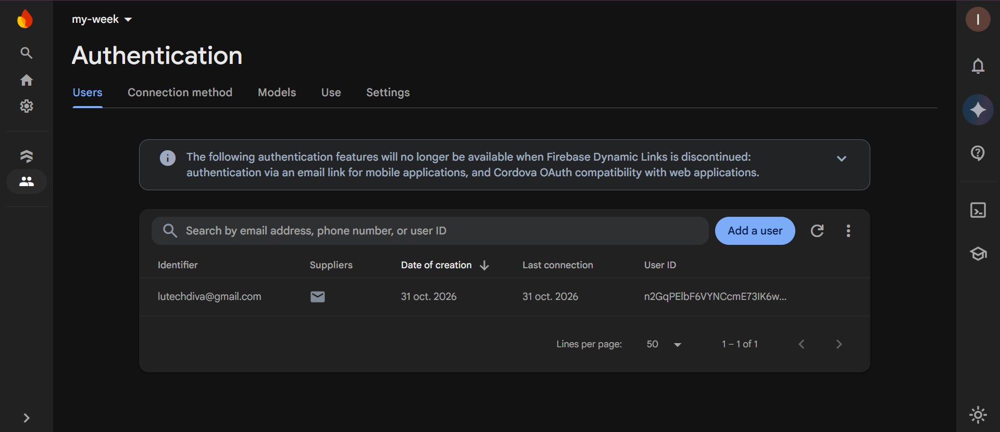<br>
      <sub>Authentication: the account I created.</sub>
    </td>
    <td align="center">
      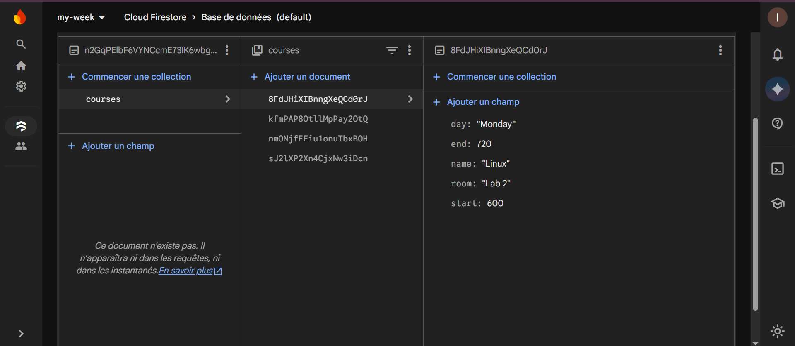<br>
      <sub>Firestore: users, my id, courses, with one document per course.</sub>
    </td>
  </tr>
  <tr>
    <td align="center">
      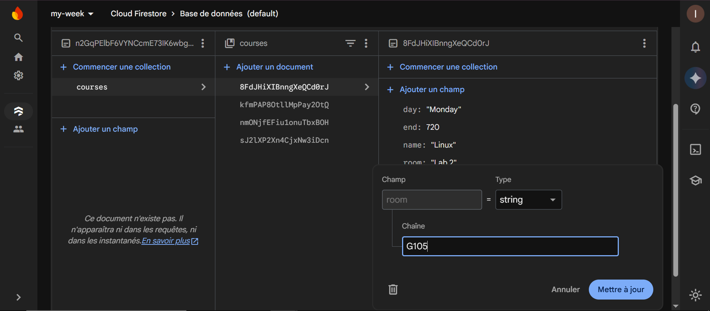<br>
      <sub>Editing the room of a course directly in the console.</sub>
    </td>
    <td align="center">
      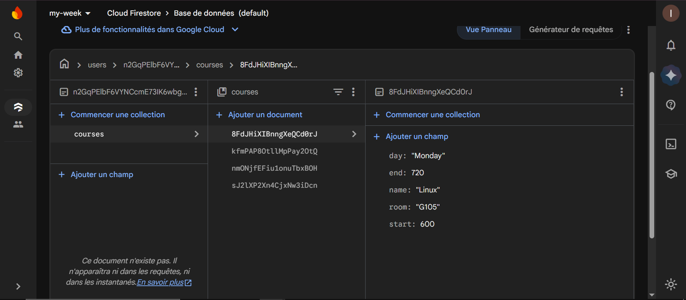<br>
      <sub>The saved document after the edit.</sub>
    </td>
  </tr>
</table>

<details>
<summary><b>Session 5 screenshots (before Firebase)</b></summary>

<table align="center">
  <tr>
    <td align="center">
      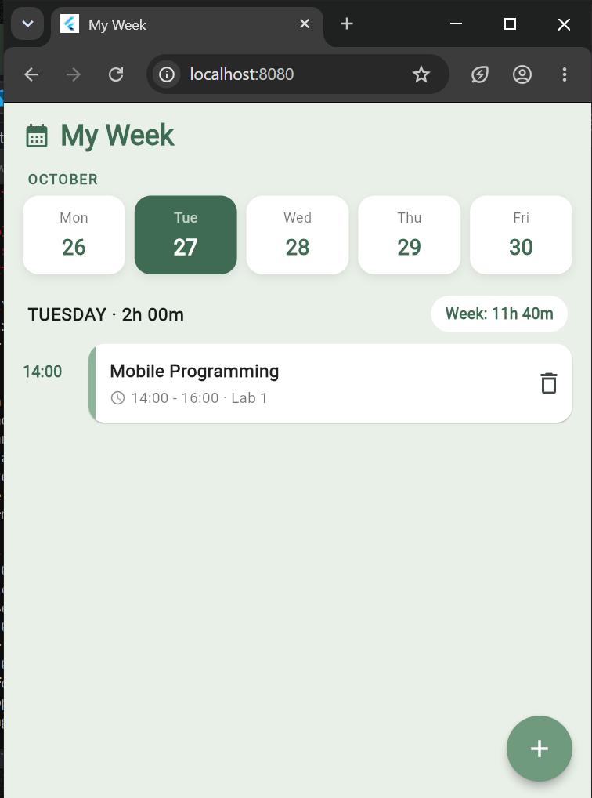<br>
      <sub>Before closing: courses I added, with a clash in red.</sub>
    </td>
    <td align="center">
      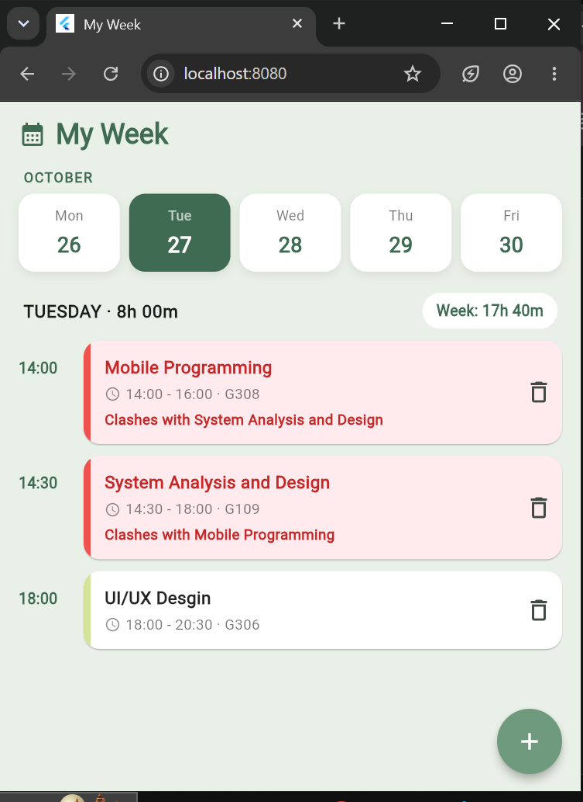<br>
      <sub>After running again: everything is still there.</sub>
    </td>
  </tr>
  <tr>
    <td align="center">
      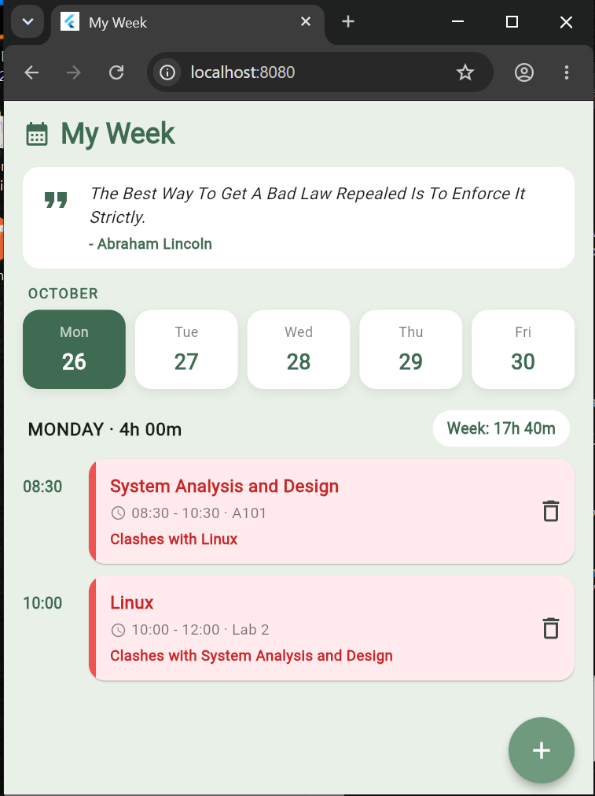<br>
      <sub>Live data: a quote from the DummyJSON API.</sub>
    </td>
    <td align="center">
      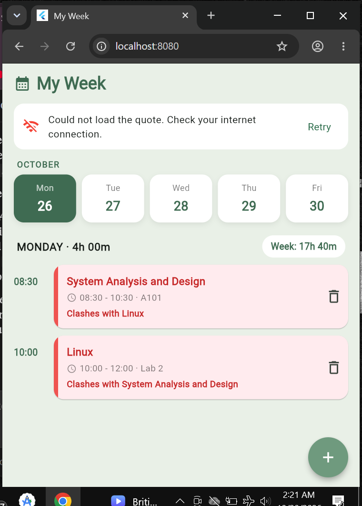<br>
      <sub>No internet: a clear message and a Retry button.</sub>
    </td>
  </tr>
</table>

</details>

---

<h2 align="center">How it works, for another beginner</h2>

**1. Every app is data, a screen, and actions.**
The data is the list of courses. The screen draws that list. When the user taps something, an action changes the data, and the screen draws again. In Flutter, the line that says "the data changed, draw again" is `setState`. With Firebase, the screen listens to the data and draws again by itself.

**2. Times are stored as minutes.**
`08:30` is saved as `510` (8 x 60 + 30). Numbers can be compared, sorted and subtracted, while text like `"08:30"` cannot. This one choice makes the clash check and the hour totals simple.

**3. The clash rule.**
Two courses clash when they are on the same day and each one starts before the other ends:

```dart
a.startMinutes < b.endMinutes && b.startMinutes < a.endMinutes
```

I use `<` and not `<=`, so a class ending at 11:00 and another starting at 11:00 do not count as a clash.

**4. Accounts and the gate.**
`FirebaseAuth` creates accounts and logs people in. `AuthGate` is the first screen: it listens to `authStateChanges()`, which is a Stream (a pipe that keeps delivering new answers). If nobody is logged in, it shows the login screen. If someone is, it shows the week. Logging out is one line, `FirebaseAuth.instance.signOut()`, and the gate switches back to the login screen by itself.

**5. Saving the data in Firestore.**
Each course is turned into a Map (`toMap`) and saved as one document at `users/{userId}/courses/{courseId}`. A document read back becomes a course again (`Course.fromDoc`). Add uses `add`, edit uses `update`, delete uses `delete`, and Undo writes the same data back with `set`. A new account gets three sample courses once, with a batch write.

**6. The list is live.**
The week screen uses a `StreamBuilder` on `snapshots()`. It rebuilds every time Firestore delivers a new list, so there is no `setState` for the data and no refresh button. It has three states: a spinner while loading, an error message if something fails (for example `permission-denied`), and the list on success. A free day shows an empty message.

**7. Save the facts, compute the rest.**
Only the courses are saved. The hours of the day, the hours of the week and the clashes are never saved: the app computes them each time the list arrives. So they can never disagree with the courses, and when I delete one, the totals change at once.

**8. The security rules.**
The app's code runs on the user's device, so the server cannot trust it. The rules run on the server and check every read and write:

```
match /users/{userId}/{document=**} {
  allow read, write: if request.auth != null && request.auth.uid == userId;
}
```

In words: you can only read and write under `users/your-own-id/`, and only when you are logged in as that user.

---

<h2 align="center">Think questions</h2>

**My Week: write your clash condition in plain words. Why `<` and not `<=`?**
Two courses clash when they are on the same day and each one starts before the other one ends. I use `<` and not `<=` because a class that ends at 11:00 and another that starts at 11:00 only touch each other. They do not overlap, so they should not turn red. With `<=` they would be flagged by mistake.

**Session 5: what would happen to the screen if `http.get` made the app wait without `async` and `await`?**
The whole screen would freeze: no taps would work and the spinner would stop turning until the server answered. On a slow connection that can last many seconds, so the person would think the app is broken. With `await`, only that one line waits, and the rest of the app keeps running and drawing.

**Session 5: what happens to the saved data if I change phone or open the app on a second phone? What kind of place would keep it for every phone?**
In Session 5 the data was saved on one device only, so another phone would start with the sample courses. With Session 6 this is solved: the courses live on a server (Firestore), under the account, so on any phone I log in and see the same courses.

---

<h2 align="center">Project structure</h2>

```
my_week/
  lib/
    main.dart          start of the app, the week screen, the form, clash and time rules, Firestore functions
    login_screen.dart  login and create account (with confirm password)
    auth_gate.dart     shows the login screen or the week, depending on who is logged in
    quote.dart         the Quote model and fetchQuote()
  android/app/google-services.json   the app's address card for Firebase
  screenshots/         the images shown above
  pubspec.yaml         the list of packages the app uses
```

---

<h2 align="center">Run it yourself</h2>

You need the Flutter SDK and Google Chrome (or an Android phone or emulator).

```
git clone https://github.com/Mrs-luwase/my_week.git
cd my_week
flutter pub get
flutter run -d chrome
```

The app connects to my Firebase project. To use your own, create a Firebase project, turn on Email/Password in Authentication, create a Firestore database, publish the rules above, and replace `google-services.json` and the web values in `main.dart`. On Windows, Developer Mode must be switched on for the Firebase packages.

---

<h2 align="center">What I learned</h2>

- A widget is a building block of the screen, and a screen is blocks inside blocks.
- A screen that never changes can be stateless. A screen that must remember something that changes needs a State, and changes go inside `setState`.
- Rules (checking times, finding clashes) belong in functions outside the screens, so I can test them alone.
- A Future gives one answer and is done. A Stream is a pipe that keeps delivering. `StreamBuilder` redraws the screen at every new answer.
- Firebase gives an app a backend without writing a server: accounts, a database and rules.
- The rules on the server are the real protection. Hiding a screen in the app is not security.
- Save the facts and compute the rest: totals and clashes are calculated, never saved.
- Hot reload keeps the app's memory, hot restart resets it, and adding a new package needs a full stop and run.

---
<h2 align="center">Challenges I met</h2>

- **The emulator.** The phone emulator was very slow and crashed on my computer, so I ran and tested the app in Chrome, in a narrow window so the screen is close to a phone's size. All the screenshots come from Chrome.
- **Firebase on the web needs its own settings.** `google-services.json` only works on Android. To run in Chrome I registered a web app in the Firebase console and gave `Firebase.initializeApp` those values, only when the app runs on the web.
- **Windows Developer Mode.** The packages could not be added until Developer Mode was switched on.
- **A flood of build errors from Flutter's own files.** Hundreds of errors pointed inside the Flutter folder, not at my code. I re-downloaded Flutter's components with `flutter precache --force`, checked that a new empty app ran in Chrome, and then ran My Week in Chrome.
- **A file in the wrong folder.** `google-services.json` was in `android/` and must be in `android/app/`.
- **A page that translated itself.** Chrome translated the Firebase console from French, and turned `courses` into "races". The collection was always `courses`.
- **Stateless and stateful, API workarounds, Future, async, await** took me a few rounds to understand. What helped was asking one question at a time, for example: does this screen need to remember something that changes?

---
<h2 align="center">Limits and next steps</h2>

- There is no "forgot my password" button yet. Firebase can send a reset email, and I would add it next.
- The quote changes every time the app opens. A true "quote of the day" would save today's date and quote, and only ask the server once per day.
- Only Monday to Friday is supported.
- The web settings in `main.dart` are public by design: the security rules protect the data, not the keys.
- Next, I would split `main.dart` into smaller files (one per screen) and write a few tests for the clash and time rules.

---


<h2 align="center">Acknowledgements</h2>

- Course material from the Mobile Programming course training
- The DummyJSON public API for the quote data
- Step-by-step guidance from a model tutor (Claude), which I used to understand each part of the code.

---

<h2 align="center">Signature</h2>

**Author : Leiss Uwase ID 27064**

---
